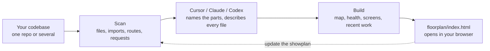

<div align="center">

<picture>
  <source media="(prefers-color-scheme: dark)" srcset="docs/images/logo-dark.png">
  
</picture>

# Showplan

**See how your app actually fits together.**

Your coding agent reads your codebase and draws an interactive map of it. Every part, file and web request gets a plain-language name (in your language), and every connection between them is shown.

[](docs/cursor.md)
[](https://code.claude.com/docs/en/overview)
[](docs/codex.md)
[](https://github.com/Onivoid/Showplan/actions/workflows/test.yml)
[](CHANGELOG.md)
[](LICENSE)
[](https://nodejs.org)
[](#how-it-works)

**[Docs](docs/README.md)** · [Using Showplan in Cursor](#using-showplan-in-cursor) · [Install](#install) · [Quick start](#quick-start) · [Features](#features)

</div>

> **Attribution.** Showplan is based on [Floorplan](https://github.com/haydenschmitty/floorplan) by Hayden Smith. The technical core (scan, graph, map folder `floorplan/`) stays compatible enough that selective upstream updates remain possible. Thank you to Hayden and the Floorplan contributors.

## Why Showplan?

You built an app, probably with a lot of help from AI, and it works. But ask "what happens when someone checks out?" or "what breaks if I change this?" and the honest answer is often *no idea*.

Showplan gives you the diagram nobody drew. Ask your agent for a showplan and a few minutes later you have a map you can explore, ask questions on, and keep up to date as you work — with names and descriptions written in **your language**.

- **For builders:** understand the app you made, in your own words, without reading the code.
- **For teams:** onboard someone in minutes, from the big picture down to the exact file.
- **For working with AI:** after every change, see exactly which parts were touched and why.

## Features

- **A map at every zoom** — whole app → part → file → endpoints, with what uses what.
- **Your language everywhere** — architecture labels, descriptions, recent work and tour notes match the conversation (or a language you request).
- **Real connections, across repos** — imports plus frontend requests matched to backend endpoints.
- **Ask the map** — questions come back with an answer board and optional walkthrough.
- **Health check** — keys in code, open tables/rules, unsigned webhooks, endpoints anyone can use.
- **Recent work** — cards your AI just changed light up with notes.
- **Blueprints** — plan an app from a PRD before the code exists.

The map lives in a `floorplan/` folder at the project root (name kept for upstream compatibility). Nothing in that folder is committed.

## Using Showplan in Cursor

Showplan is **Cursor-first**. You need [Node.js 18+](https://nodejs.org).

Install the skill into the project (or your user skills):

```bash
npx skills add Onivoid/Showplan --skill showplan -a cursor
```

That places it under `.cursor/skills/showplan/` or `.agents/skills/showplan/`. You can also copy `skills/showplan` there by hand. On a local clone, use `.` instead of `Onivoid/Showplan`.

Start a new chat and ask:

> Make me a showplan of this app.

Or type `/showplan`. For a frontend and backend in separate repos, open the folder that holds both.

Cursor does not expand Claude Code's `${CLAUDE_SKILL_DIR}`: the skill tells the agent to use the folder that contains `SKILL.md`. Scripts then find their own files from that path.

The map opens in your browser. If the agent can't keep the map server running, from the project folder:

```bash
node floorplan/serve.mjs
```

On a map made in Cursor, the Ask bar waits for that chat: leave `ask-poll.mjs` running beside the map (see [Showplan in Cursor](docs/cursor.md)). `--engine claude` or `--engine codex` answers with one of those instead.

## Install

### Cursor (recommended)

See [Using Showplan in Cursor](#using-showplan-in-cursor) above.

### Claude Code

```bash
claude plugin marketplace add Onivoid/Showplan
claude plugin install showplan@showplan
```

### Codex

```bash
codex plugin marketplace add Onivoid/Showplan
codex plugin add showplan@showplan
```

Or add the marketplace in the Codex app UI. More in [Showplan in Codex](docs/codex.md).

## Quick start

1. Open your project in Cursor (or Claude Code / Codex).
2. Ask: *Make me a showplan of this app.*
3. Explore. The map opens on its own, starting with a short tour.

When you've done more work:

> Update the showplan.

Only what changed is re-read, and what you just worked on lights up under **Recent work**.

**No code yet?** Share a PRD or spec and ask for a blueprint of what you'd need to build.

## How it works



Scripts do the mechanical work in plain Node with **no dependencies**. The agent decides what the parts of your app *are*, and says so plainly in your language. Details in [How it works](docs/how-it-works.md).

## Documentation

| | |
|---|---|
| [Getting started](docs/getting-started.md) | Install, first map, updating, planning from a PRD |
| [Showplan in Cursor](docs/cursor.md) | Installing and using it in Cursor (primary) |
| [Showplan in Codex](docs/codex.md) | Installing and using it in Codex |
| [Using the map](docs/using-the-map.md) | Buttons, views, shortcuts |
| [How it works](docs/how-it-works.md) | Pipeline, matching, refreshes |
| [What's in your project](docs/project-files.md) | Files Showplan creates |
| [Privacy and security](docs/privacy-and-security.md) | What runs where |
| [Troubleshooting](docs/troubleshooting.md) | Common problems |
| [Developing Showplan](docs/development.md) | Repo layout, local installs |

## Privacy

The scan, the map and its local server run on your computer. No analytics. Questions on the map go through your own agent account. More in [Privacy and security](docs/privacy-and-security.md).

## License

[MIT](LICENSE). Showplan is based on [Floorplan](https://github.com/haydenschmitty/floorplan) by Hayden Smith.
